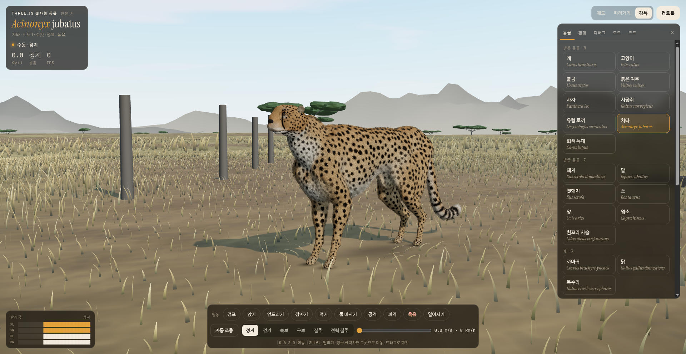
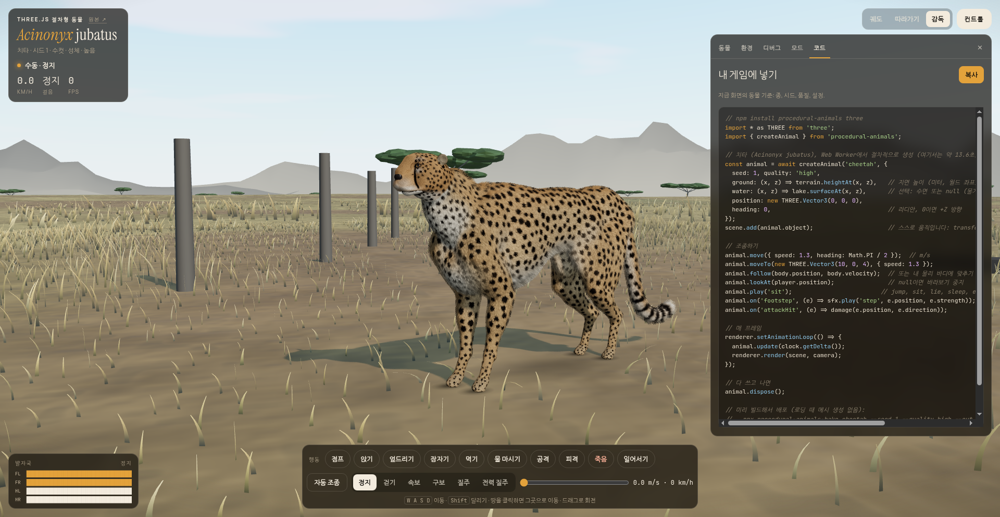

# three.js 절차형 동물 — 한글판 (Procedural Animals KO)

**[한글 쇼케이스 바로 실행](https://sigco3111.github.io/procedural-animals-ko/)** · [원본 저장소](https://github.com/majidmanzarpour/threejs-procedural-animals) · [원본 라이브 쇼케이스](https://majidmanzarpour.github.io/threejs-procedural-animals/)

three.js를 위한 동물 24종을 전부 코드로 생성하는 라이브러리입니다. 모델 파일도, 텍스처도, 애니메이션 클립도 없습니다.
`createAnimal('wolf')`를 호출해 씬에 추가하고 조종하면 됩니다.

이 저장소는 원본의 **한글화 포크**입니다. 쇼케이스 UI, 동물 이름, 데모 릴 자막, 코드 생성기 출력이 한글로 표시됩니다.



## 주요 특징

- **24종, 6가지 체형:** 발톱 동물, 발굽 동물, 새, 수생 동물, 뱀, 거미 (깡충 동물 포함). 품종·털색·모프, 암수, 어린 개체까지 지원.
- **실행 시점 생성:** 부호 있는 거리 필드(SDF)로 조각하고, 메시 생성, 리깅, 스키닝(듀얼 쿼터니언), 털·깃털·비늘 덮개, IK 보행과 행동까지 전부 코드로 만듭니다.
- **시드 기반 개체:** `seed` 값으로 크기·비율·털색이 다른 반복 가능한 개체를 만듭니다.
- **클로즈업부터 군중까지:** 다섯 단계 품질 — `hero`(정점 약 12만 개)부터 `crowd`(정점 약 6천 개, 드로 콜 1개)까지.
- **메인 스레드 분리:** Web Worker에서 생성하거나, 오프라인에서 베이크해 즉시 로딩할 수 있습니다.



## 설치

```sh
npm install procedural-animals three
# npm 배포 전까지는:
npm install github:majidmanzarpour/threejs-procedural-animals three
```

유일한 (피어) 의존성은 three.js r160 이상입니다. 타입 선언이 포함된 순수 ES 모듈입니다.

## 빠른 시작

```js
import * as THREE from 'three';
import { createAnimal } from 'procedural-animals';

const renderer = new THREE.WebGLRenderer({ antialias: true });
renderer.setSize(innerWidth, innerHeight);
renderer.shadowMap.enabled = true;
document.body.appendChild(renderer.domElement);

const scene = new THREE.Scene();
scene.background = new THREE.Color(0xa9c1e0);
const camera = new THREE.PerspectiveCamera(40, innerWidth / innerHeight, 0.1, 500);
camera.position.set(6, 3, 8);
const sun = new THREE.DirectionalLight(0xfff3e4, 2.7);
sun.position.set(6, 10, 4);
sun.castShadow = true;
scene.add(sun, new THREE.HemisphereLight(0xdde6f2, 0x5f5a52, 1.15));
const floor = new THREE.Mesh(new THREE.PlaneGeometry(200, 200).rotateX(-Math.PI / 2), new THREE.MeshStandardMaterial({ color: 0x77736a }));
floor.receiveShadow = true;
scene.add(floor);

async function main() {
  const wolf = await createAnimal('wolf', { seed: 3, quality: 'high' });
  scene.add(wolf.object); // wolf.object는 직접 움직이지 마세요: 동물이 스스로 움직입니다

  let last = performance.now();
  renderer.setAnimationLoop((now) => {
    const dt = (now - last) / 1000; // 초
    last = now;
    wolf.move({ speed: wolf.gears.walk, heading: now / 1000 * 0.3 }); // m/s, 라디안
    wolf.update(dt); // 매 프레임 한 번
    camera.lookAt(wolf.position);
  });
}
main();
```

전체 API와 고급 기능(지면·수면 함수, 퍼치, 베이크, 군집)은 [원본 README](https://github.com/majidmanzarpour/threejs-procedural-animals#readme)와 `llms.txt`를 참고하세요.

## 쇼케이스 로컬 실행

```sh
npm install
npm run build:showcase   # dist/showcase.html 생성 (단일 파일, 브라우저로 바로 열기)
npm run build:pages      # dist/pages/ 생성 (정적 배포용)
npm test                 # 24종 생성·행동 회귀 테스트
```

## 기술 노트

- 쇼케이스는 `showcase/build.mjs`로 라이브러리·three.js·빌드 워커까지 하나의 HTML로 인라인합니다. 외부 리소스는 Google Fonts 스타일시트뿐입니다.
- 한글화는 표시 문자열에만 적용했습니다. 종·변이·보행·행동의 **id는 영문 그대로**라 원본 API와 완전히 호환됩니다 (`createAnimal('wolf')` 등 동일하게 동작).
- 한글 표시 매핑은 `showcase/src/ko.js`에 모여 있습니다.

## 한글화 범위

- 쇼케이스 전체 UI: 제목, 패널(동물/환경/디버그/모드/코드), 토글, 버튼, 힌트, 로딩 화면, 접근성 레이블
- 24종 표시 이름과 변이·품종 이름 (학명은 원문 유지)
- 보행(걷기·속보·질주 등)과 행동 칩(포효·그루밍·덮치기 등 60여 종) 한글 표시
- 상태 표시줄, 토스트, 성능 HUD 레이블
- 데모 릴: 종 자막, "만드는 과정" 단계 표시, 오프닝·엔딩 타이틀
- 코드 생성기 출력의 주석

## 라이선스·출처

- 원작: [threejs-procedural-animals](https://github.com/majidmanzarpour/threejs-procedural-animals) by **Majid Manzarpour**, MIT License (원본 [LICENSE](LICENSE) 그대로 포함).
- 이 한글화 포크도 같은 MIT 라이선스를 따릅니다.
